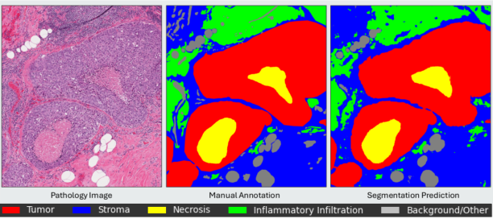

# Breast Segmentation
This repository provides source code for breast segmentation using Deep Multi-Magnification Network. Deep Multi-Magnification Network automatically segments multiple tissue subtypes by a set of patches from multiple magnifications in histopathology whole slide images. The original Deep Multi-Magnification Network paper is published [here](https://doi.org/10.1016/j.compmedimag.2021.101866) and its training and inference codes can be found [here](https://github.com/MSKCC-Computational-Pathology/DMMN).



## Prerequisites
* Python 3.6.7
* Pytorch 1.3.1
* OpenSlide 1.1.1
* Albumentations

## Inference
The main inference codes are `slidereader_coords.py` and `inference.py`. 

- Unpack the zip folder $\color{red}{\text{'ptsemseg'}}$ and put it in the same place as the executive files. 
- You first need to run `slidereader_coords.py` to generate patch coordinates to be segmented in the input whole slide images. 
- After generating patch coordinates, you may run `inference.py` to generate segmentation predictions of input whole slide images.
- The segmentation predictions will be saved under `imgs/` by default.

You may need to update the following variables before running `slidereader_coords.py`:
* `slides_to_read`: the list of whole slide images
* `coord_file`: an output file listing all patch coordinates

In addition to `model_path` and `out_path`, you may need to update the following variables before running `inference.py`:
* `test file`: the list of patch coordinates generated by `slidereader_coords.py`
* `data_path`: the path where whole slide images are located

Please download **the pretrained breast segmentation model** [here](https://huggingface.co/hainct/dmmn_breast/tree/main). 

Note that segmentation predictions will be generated in 4-bit BMP format. The size limit for 4-bit BMP files is 2<sup>32</sup> pixels.

## Other pretrained segmentation models
Please find other pretrained segmentation models using Deep Multi-Magnification Network:
* **Ovarian model** [here](https://github.com/MSKCC-Computational-Pathology/DMMN-ovary).
* **Osteosarcoma model** [here](https://github.com/MSKCC-Computational-Pathology/DMMN-osteosarcoma).
* **Lung model** [here](https://github.com/davidholab/DMMN-lung).

## License
This project is under the CC-BY-NC 4.0 license. See [LICENSE](LICENSE.md) for details.

## Acknowledgments
* This code is inspired by [pytorch-semseg](https://github.com/meetps/pytorch-semseg) and [MICCAI 2017 Robotic Instrument Segmentation](https://github.com/ternaus/robot-surgery-segmentation).

## Reference
If you find our work useful, please cite our [paper]():

<!--```
@article{ho2025,
  title={},
  author={Ho, David Joon},
  journal={Modern Pathology},
  year={2026},
  month={},
  volume={},
  number={},
  pages={}
}
``` -->
